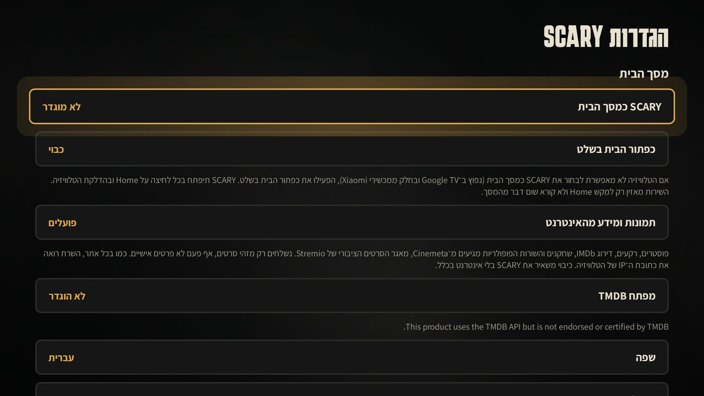
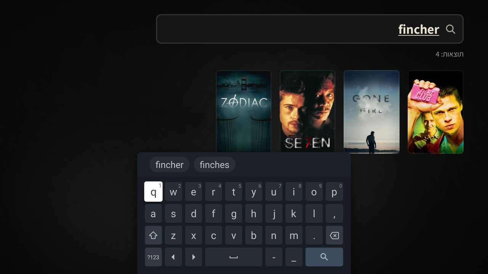
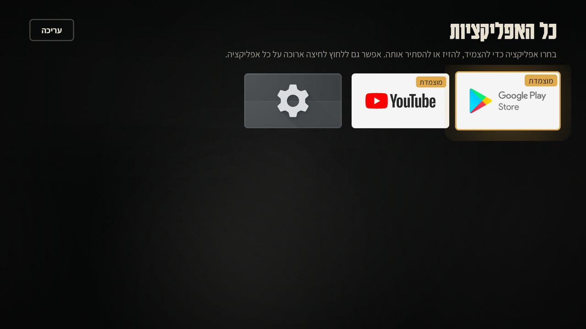
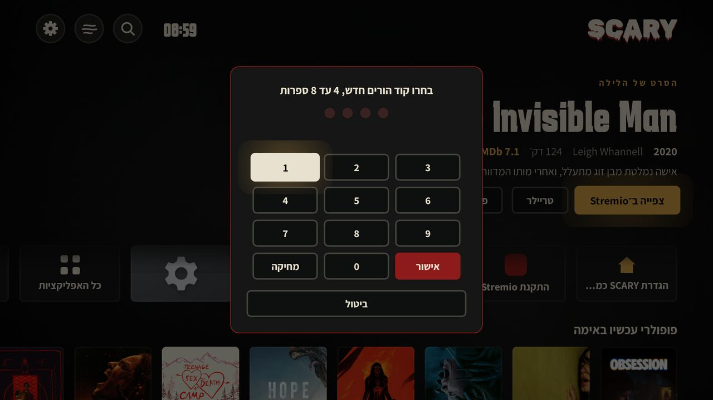
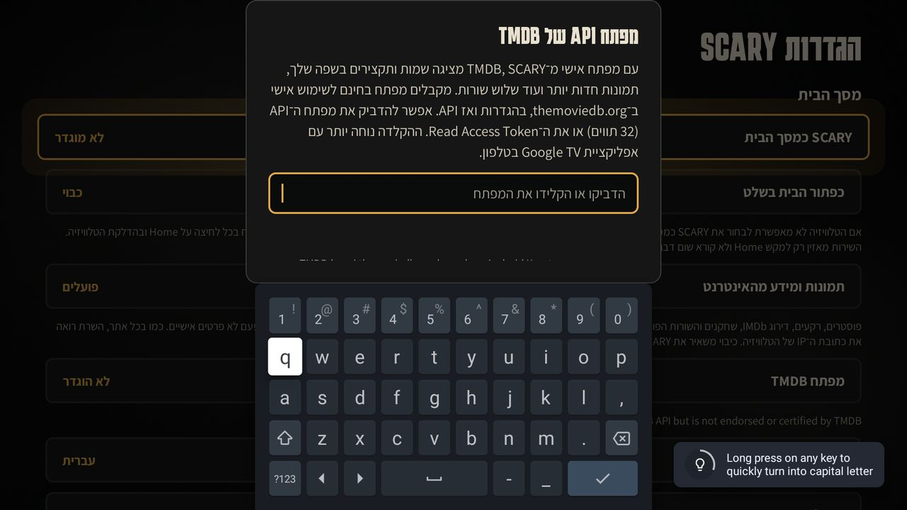

<p align="center"></p>

<h1 align="center">SCARY</h1>

<p align="center">
A horror-movie home screen (launcher) for Android TV<br>
<a href="#english">English</a> · <a href="#עברית">עברית</a> · <a href="#português">Português</a> · <a href="#русский">Русский</a>
</p>

<p align="center">
<a href="https://github.com/diamondrubinny/Scary/releases/download/latest-build/scary.apk"><b>⬇ Download the latest APK</b></a>
</p>

All screenshots are real: CI installs the APK on an Android TV emulator (1080p) and captures them on every build.

---

## English

SCARY replaces the Android TV home screen with a horror-themed one. It brings together a curated library of horror and psychological thrillers, Stremio, Google Play and your installed TV apps. It does not stream or host video: selecting a movie opens it in Stremio.

| Home | Movie page | Settings |
|---|---|---|
|  |  |  |

- **52 hand-picked films** with an editorial fear meter (1–5), plus popular horror, thriller and mystery rows that update daily.
- **Real artwork**: posters, full-screen backgrounds, IMDb ratings and cast from Cinemeta. Works offline from a local cache.
- **Optional TMDB key** (in settings): titles and synopses in your language, sharper art, three more rows. Stored encrypted with the Android Keystore.
- **A real launcher**: asks the system to become the home screen, or, where the TV does not allow it (Google TV, many Xiaomi boxes), an optional accessibility service maps the remote's Home button to SCARY.
- **Parental lock** with a PIN, offline search, all-apps drawer with pin/hide/reorder, fog and film-grain atmosphere you can switch off, optional ambient sound.
- **Four languages**: Hebrew (right to left), English, Portuguese and Russian.

Install guide: [docs/XIAOMI_SETUP.md](docs/XIAOMI_SETUP.md) (Hebrew).

## עברית

SCARY מחליפה את מסך הבית של Android TV במסך בית בעיצוב אימה. היא מרכזת מאגר סרטי אימה ומתח פסיכולוגי, Stremio, חנות Play ואת אפליקציות הטלוויזיה שלך. היא לא מזרימה וידאו: בחירה בסרט פותחת אותו ב־Stremio.

| מסך הבית | עמוד סרט | הגדרות |
|---|---|---|
|  |  |  |

- **52 סרטים נבחרים** עם מד פחד עריכתי (1–5), ושורות פופולריות של אימה, מתח ותעלומה שמתעדכנות כל יום.
- **תמונות אמיתיות**: פוסטרים, רקעים במסך מלא, דירוג IMDb ושחקנים מ־Cinemeta. עובד גם בלי אינטרנט ממטמון מקומי.
- **מפתח TMDB אופציונלי** (בהגדרות): שמות ותקצירים בשפה שלך, תמונות חדות יותר ועוד שלוש שורות. נשמר מוצפן ב־Android Keystore.
- **לאנצ׳ר אמיתי**: בקשה מהמערכת להיות מסך הבית, ואם הטלוויזיה לא מאפשרת (Google TV, הרבה מכשירי Xiaomi), שירות נגישות אופציונלי שהופך את כפתור Home בשלט לפתיחת SCARY.
- **נעילת הורים** בקוד, חיפוש בלי אינטרנט, מגירת אפליקציות עם הצמדה, הסתרה וסידור, ערפל וגרעיניות שאפשר לכבות וצלילי אווירה.
- **ארבע שפות**: עברית (מימין לשמאל), English, Português, Русский.

מדריך התקנה: [docs/XIAOMI_SETUP.md](docs/XIAOMI_SETUP.md).

## Português

O SCARY substitui a tela inicial do Android TV por uma tela com clima de terror. Ele reúne uma biblioteca selecionada de filmes de terror e suspense psicológico, o Stremio, o Google Play e os apps instalados na TV. Ele não transmite vídeo: ao escolher um filme, ele abre no Stremio.

| Tela inicial | Página do filme | Configurações |
|---|---|---|
|  |  |  |

- **52 filmes escolhidos a dedo** com um medidor de medo editorial (1–5), além de listas populares de terror, suspense e mistério atualizadas todo dia.
- **Imagens reais**: pôsteres, fundos em tela cheia, notas do IMDb e elenco vindos do Cinemeta. Funciona offline a partir de um cache local.
- **Chave do TMDB opcional** (nas configurações): títulos e sinopses no seu idioma, imagens mais nítidas e mais três listas. Guardada com criptografia no Android Keystore.
- **Um launcher de verdade**: pede ao sistema para ser a tela inicial ou, quando a TV não deixa (Google TV, muitos aparelhos Xiaomi), um serviço de acessibilidade opcional faz o botão Home do controle abrir o SCARY.
- **Bloqueio dos pais** com PIN, busca offline, gaveta de apps com fixar, ocultar e reordenar, névoa e granulação que podem ser desligadas e sons de ambiente.
- **Quatro idiomas**: hebraico (da direita para a esquerda), inglês, português e russo.

## Русский

SCARY заменяет главный экран Android TV на экран в стиле фильмов ужасов. Он собирает в одном месте подборку ужасов и психологических триллеров, Stremio, Google Play и установленные на ТВ приложения. Он не транслирует видео: выбранный фильм открывается в Stremio.

| Главный экран | Страница фильма | Настройки |
|---|---|---|
|  |  |  |

- **52 отобранных фильма** с редакционной шкалой страха (1–5) и популярные подборки ужасов, триллеров и загадок, которые обновляются каждый день.
- **Настоящие изображения**: постеры, полноэкранные фоны, рейтинги IMDb и актёры из Cinemeta. Работает офлайн из локального кэша.
- **Ключ TMDB по желанию** (в настройках): названия и описания на вашем языке, более чёткие изображения и ещё три подборки. Хранится в зашифрованном виде в Android Keystore.
- **Настоящий лаунчер**: просит систему сделать его главным экраном, а если ТВ этого не позволяет (Google TV, многие приставки Xiaomi), необязательный сервис спец. возможностей заставляет кнопку «Домой» на пульте открывать SCARY.
- **Родительская блокировка** по PIN-коду, офлайн-поиск, список всех приложений с закреплением, скрытием и сортировкой, отключаемые туман и зернистость плёнки, фоновые звуки.
- **Четыре языка**: иврит (справа налево), английский, португальский и русский.

---

## More screens

| Search | All apps | Parental PIN | TMDB key |
|---|---|---|---|
|  |  |  |  |

## For developers

| Module | What it is |
|--------|-----------|
| `core/` | Pure Kotlin/JVM: catalog model and validation, search, tonight's pick, Cinemeta and TMDB parsing, PIN hashing, deep links. Unit tested. |
| `app/` | Android app: Jetpack Compose UI, HOME intent filter, Home-button accessibility service, installed apps, launching. |
| `app/src/main/assets/catalog.json` | The curated library, in four languages. Validated by the `core` tests on every build. |

```bash
./gradlew :core:test          # unit tests
./gradlew :app:assembleDebug  # app/build/outputs/apk/debug/app-debug.apk
./gradlew :app:lintDebug
./gradlew -Pscary.coreOnly :core:test   # without the Android SDK
```

CI (GitHub Actions) runs the tests, builds and lints the APK, publishes it to the `latest-build` pre-release, and captures these screenshots on an Android TV emulator.

Plan and spec (Hebrew): [docs/PLAN.md](docs/PLAN.md).

## Privacy and credits

No accounts, no analytics. Online artwork can be switched off in settings; only movie IDs are sent to Cinemeta and, with your own key, TMDB. This product uses the TMDB API but is not endorsed or certified by TMDB. Movie metadata and images belong to their owners. Fonts: Karantina, Assistant, Oswald, Rubik and Rubik Wet Paint, under the SIL Open Font License 1.1.
