<p align="center">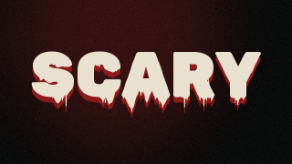</p>
<p align="center"><a href="https://www.paypal.com/donate/?hosted_button_id=U8CEQ95ECPP9J"></a><br><sub>Scan to donate · סרקו לתרומה</sub></p>

<h1 align="center">SCARY</h1>

<p align="center">
<b>The horror home screen for Android TV.</b><br>
<a href="#english">English</a> · <a href="#עברית">עברית</a> · <a href="#العربية">العربية</a> · <a href="#português">Português</a> · <a href="#русский">Русский</a> · <a href="#for-developers">Developers</a>
</p>

<p align="center">
<a href="https://github.com/diamondrubinny/Scary/releases/download/latest-build/scary.apk"></a>
<a href="https://github.com/sponsors/diamondrubinny"></a>
<a href="https://www.paypal.com/donate/?hosted_button_id=U8CEQ95ECPP9J"></a>


</p>

<table>
<tr>
<td width="33%">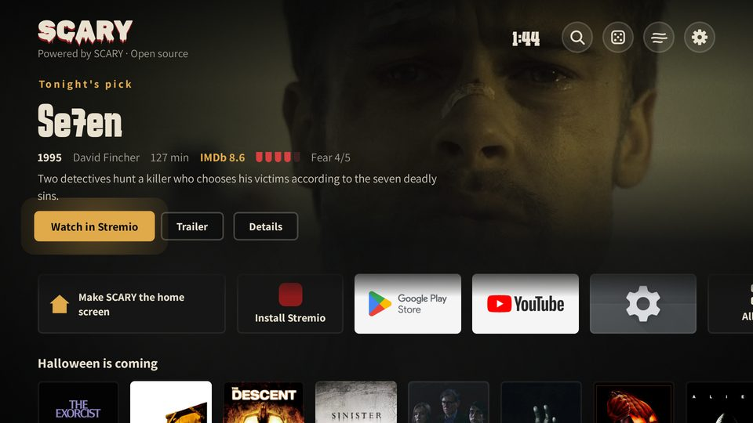<br><b>Tonight's pick</b> · a new horror film every night, full-screen artwork</td>
<td width="33%">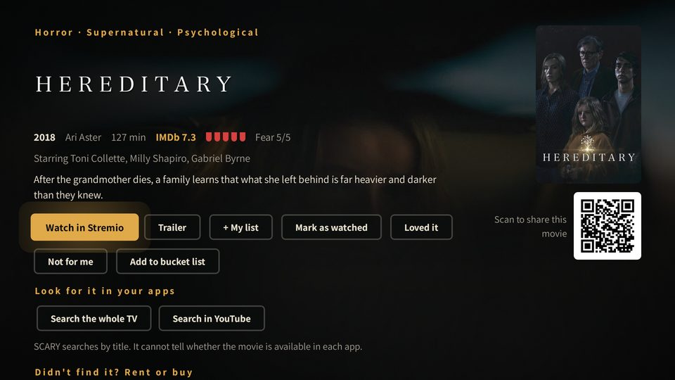<br><b>Movie pages</b> · logo art, fear meter, and a search in every app you have</td>
<td width="33%">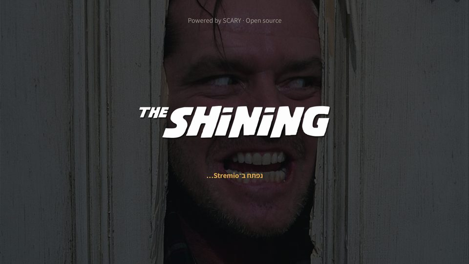<br><b>The shiver</b> · the title trembles in the dark before the movie opens</td>
</tr>
<tr>
<td>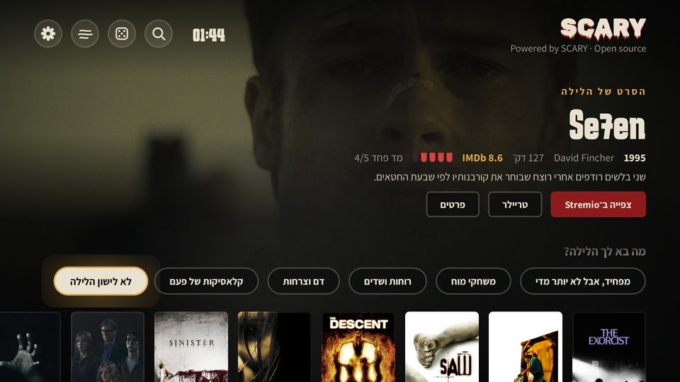<br><b>What do you feel like tonight?</b> · eight moods, from mind games to no sleep</td>
<td>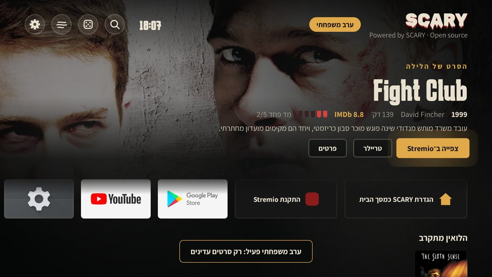<br><b>Family night</b> · only the gentlest films, PIN to leave</td>
<td>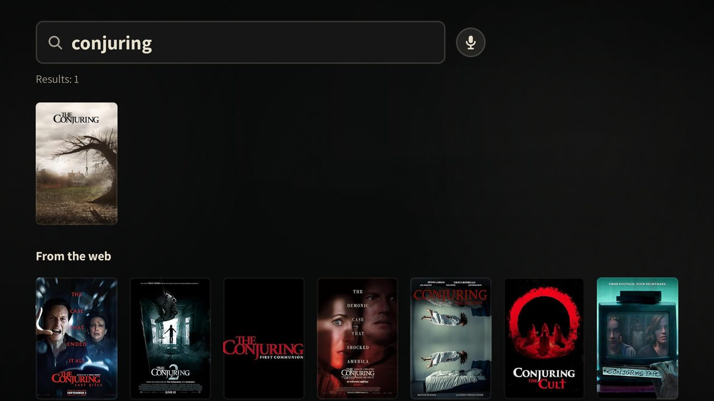<br><b>Search</b> · by text or voice, in the library and across the web</td>
</tr>
<tr>
<td>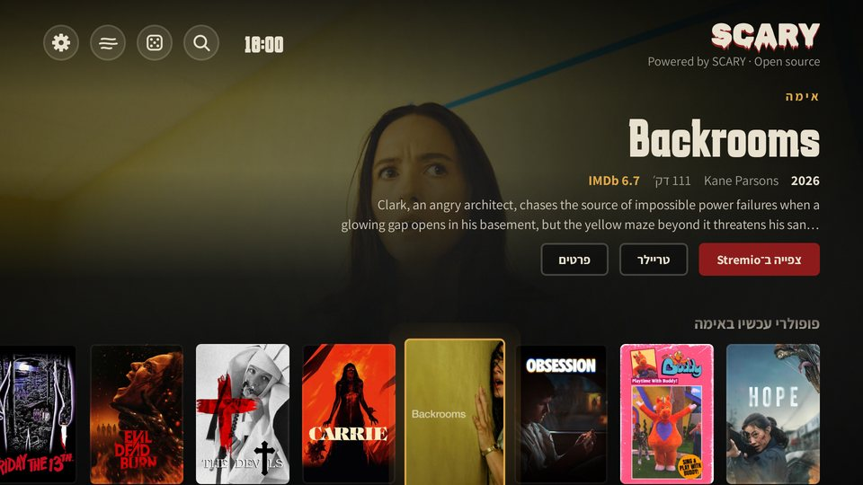<br><b>Endless rows</b> · scroll on and more films keep loading</td>
<td>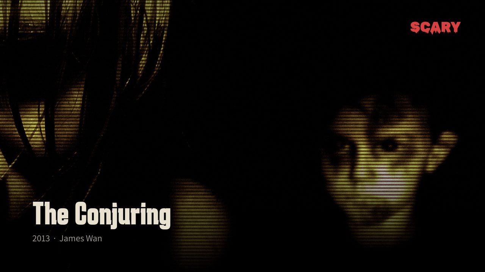<br><b>Horror screensaver</b> · backdrops that fade in the dark</td>
<td>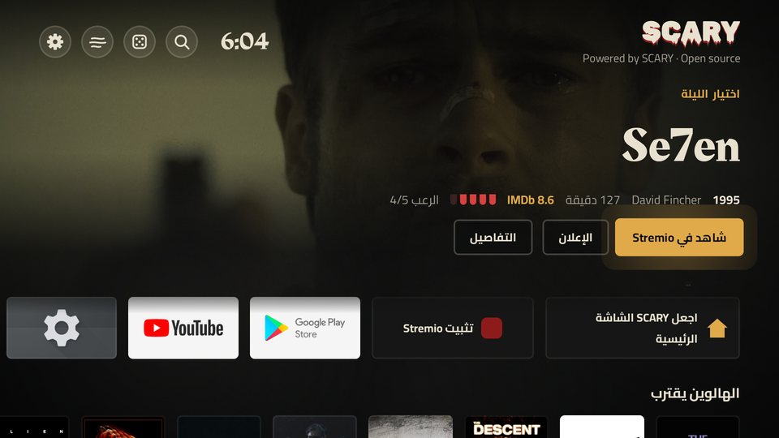<br><b>Five languages</b> · Hebrew and Arabic right to left, English, Portuguese, Russian</td>
</tr>
<tr>
<td>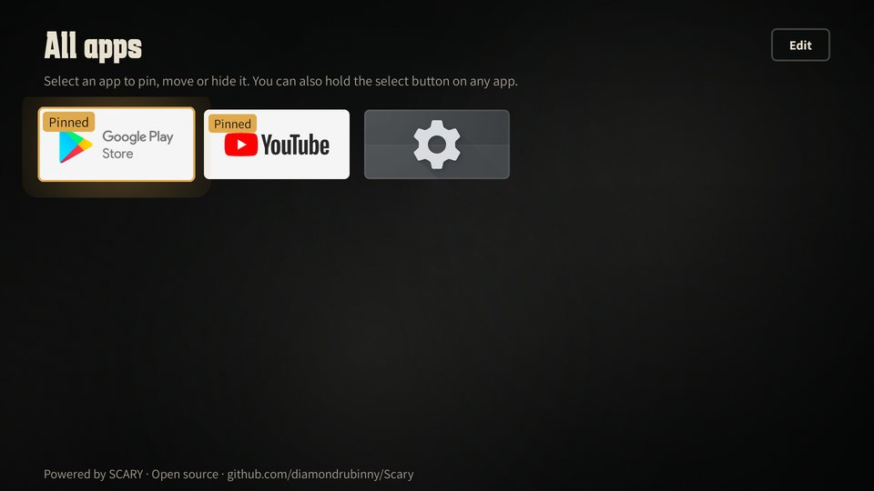<br><b>Your apps</b> · Stremio, Google Play and every TV app, pinned your way</td>
<td>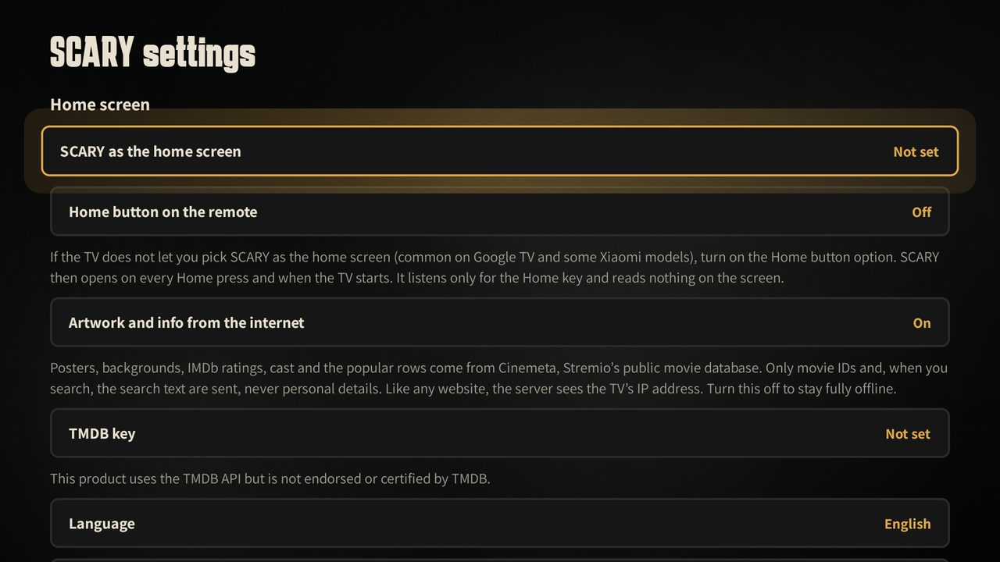<br><b>Settings</b> · parental PIN, family night, seasonal rows, effects</td>
<td>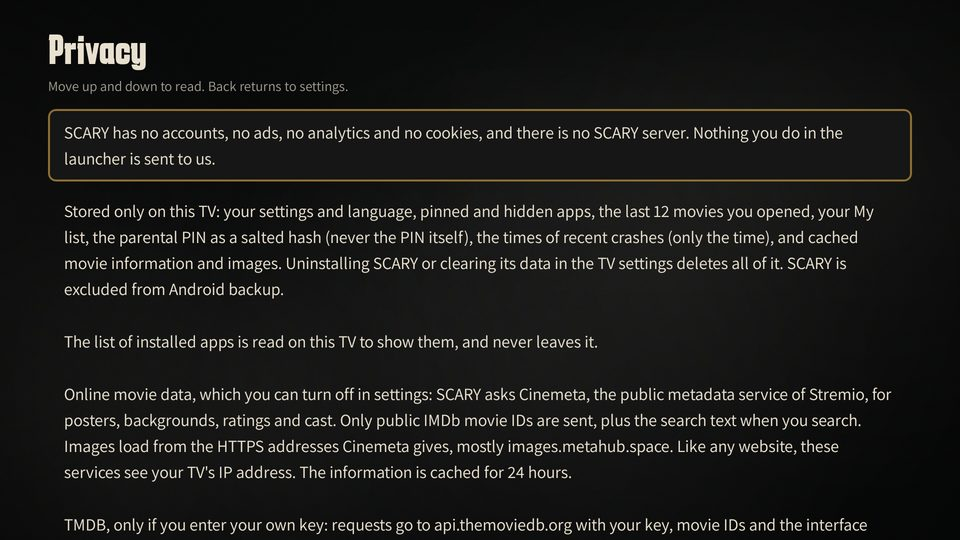<br><b>Private by design</b> · no account, no ads, no tracking</td>
</tr>
</table>

<p align="center"><sub>Real screenshots: every build is installed on an Android TV emulator (1080p) and captured automatically.</sub></p>

---

## English

### The home screen that makes you leave the lights on

SCARY turns your Android TV into a horror cinema. Instead of a plain home screen you get a hand-picked library of horror and psychological thrillers with real posters and backdrops, "Tonight's pick" every evening, and Stremio, Google Play and all your apps in one place.

**Why SCARY?**

- 🩸 **170 hand-picked films** with a fear meter (1–5), plus 7 rows from the web (popular, new this year, thrillers, mysteries) that keep loading as you scroll: thousands of films, refreshed every day.
- 🌙 **"What do you feel like tonight?"**: eight moods, from mind games and "short and sharp" to "slow-burn dread" and "no sleep tonight", or pick a decade, alone or with a mood. "Surprise me" picks from your choice. Plus special rows for Halloween and Friday the 13th.
- 🧟 **Rows for every kind of fear**: found footage, folk horror, Asian horror, zombies, vampires, body horror, haunted houses and creatures, next to the classics, slashers and psychological thrillers.
- 😱 **The shiver**: the movie's logo trembles and flickers like a dying bulb, and the screen goes dark just before the movie opens.
- 📺 **Where to watch**: search the movie in the apps you have (Netflix, Disney+, Prime Video, Apple TV, Max, YouTube, Plex and more) and in Google TV search.
- 🛒 **Didn't find it? Rent or buy**: with a TMDB key, the movie page lists the stores that rent or sell it in your country, and the services that include it. Your country comes from the TV's settings, never from your location. Data by JustWatch.
- 👨‍👩‍👧 **Family night**: only the gentlest films, everywhere, and leaving it takes a PIN.
- 🎲 **"Surprise me"**: a random film at the fear level you choose.
- 🎞️ **Trailers that play by themselves**: rest on a film and its trailer plays next to it, muted (sound is a setting). It comes from YouTube, so SCARY asks first, and you can turn it off any time.
- ⏱️ **"How much time do you have?"**: up to 90 minutes, an evening, a double feature or a marathon, with the films numbered in the order to watch them.
- ❤️ **Loved it / Not for me**: love a film and "Because you loved it" brings more like it; "not for me" keeps a film out of every suggestion. **"Your year in fear"** sums up what you watched.
- 🎟️ **Coming soon to cinemas** (with a TMDB key), and **scan to share**: a QR code on every film page opens its IMDb page on your phone, ready to share.
- 📡 **HDMI and live TV** tiles on TVs with inputs, and a **sleep timer** that pauses whatever plays.
- 🔍 **Search by text or voice**, in the library and across the web. Web results are horror, thriller and mystery only.
- ⭐ **My list and Watched**: hold OK on any poster to keep it (hold again to remove it), and mark what you have seen. Come back from a movie and SCARY marks it as watched for you.
- 🌫️ **Atmosphere**: fog, film grain and an ambient drone (all can be turned off), and a screensaver of horror backdrops.
- 🔒 **Parental lock** with a PIN, by fear level. Locked films show no poster or backdrop.
- 🕯️ **Privacy**: no account, no ads, no tracking. Everything stays on your TV.
- ♿ **Accessibility**: full remote navigation, TalkBack, high contrast, no strobing.
- 🌍 **Interface in English, Hebrew, Arabic, Portuguese and Russian**, right to left where it should be.

**Install in three minutes**

1. Allow installs from unknown sources (Settings → Device Preferences → Security & restrictions).
2. Download and install [`scary.apk`](https://github.com/diamondrubinny/Scary/releases/download/latest-build/scary.apk) (for example with Send Files to TV).
3. Open SCARY and choose **Make SCARY the home screen**. If your TV offers no choice, turn on **SCARY Home button** in the accessibility settings. Full Xiaomi guide (Hebrew): [docs/XIAOMI_SETUP.md](docs/XIAOMI_SETUP.md).

> ⚖️ **No illegal files, no video at all.** SCARY does not host, store, stream, search for or link to video files, legal or otherwise. It shows public movie information (titles, posters, ratings) and opens the movie in a streaming app that is already installed on the same device: your TV, or a tablet or phone if you install SCARY there (Stremio, Netflix, YouTube and the like). Playback happens entirely in that app, under its terms. SCARY installs and recommends no add-ons.

**Support SCARY**: the project is free and open source. If it scares you just right, you can support it on GitHub Sponsors: ☕ $3 coffee · 🍿 $5 popcorn · 🎟️ $10 movie ticket · 🔪 $25 horror night. Or [donate with PayPal](https://www.paypal.com/donate/?hosted_button_id=U8CEQ95ECPP9J): scan the code with your phone (it is also in the app, under Settings → About).

<a href="https://www.paypal.com/donate/?hosted_button_id=U8CEQ95ECPP9J"></a>

[](https://github.com/sponsors/diamondrubinny) [](https://github.com/sponsors/diamondrubinny) [](https://github.com/sponsors/diamondrubinny) [](https://github.com/sponsors/diamondrubinny)

---

<div dir="rtl">

## עברית

### מסך הבית שישאיר לכם את האור דולק

<table>
<tr>
<td width="33%">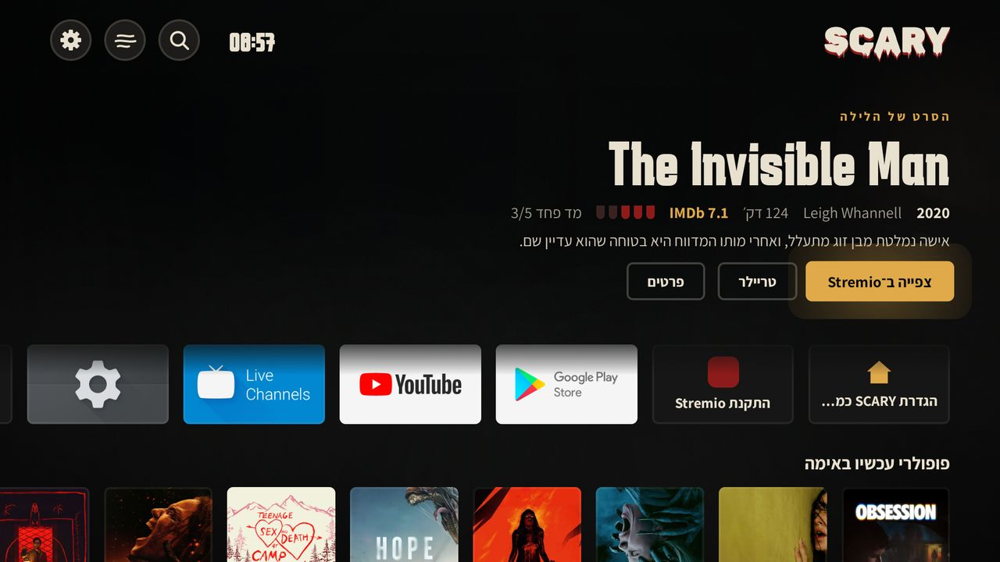</td>
<td width="33%">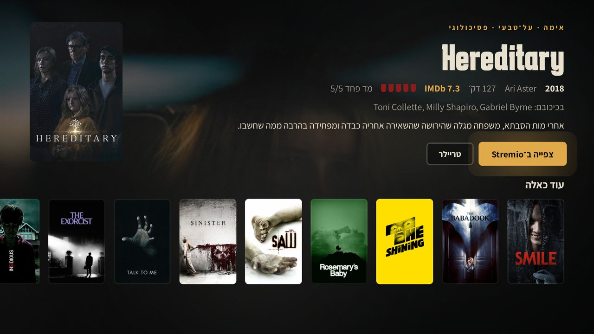</td>
<td width="33%">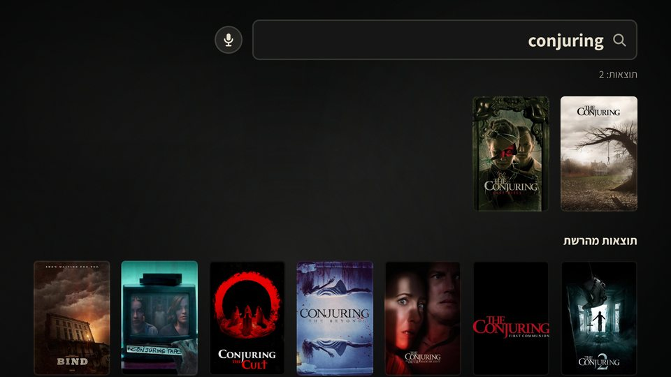</td>
</tr>
</table>

SCARY הופך את ה־Android TV שלכם לאולם קולנוע של אימה. במקום מסך בית רגיל מקבלים מאגר מאוצר של סרטי אימה ומתח פסיכולוגי עם פוסטרים ורקעים אמיתיים, "הסרט של הלילה" בכל ערב, ואת Stremio, Google Play וכל האפליקציות שלכם במקום אחד.

**למה SCARY?**

- 🩸 **170 סרטים שנבחרו ביד** עם מד פחד (1–5), ועוד 7 שורות מהרשת (פופולרי, חדש השנה, מותחנים, תעלומות) שממשיכות להיטען כשגוללים: אלפי סרטים שמתעדכנים כל יום.
- 🌙 **"מה בא לך הלילה?"**: שמונה מצבי רוח, ממשחקי מוח ו"קצר וחד" ועד "אימה שמתבשלת לאט" ו"לא לישון הלילה", או בחירת עשור, לבד או יחד עם מצב רוח. "הפתע אותי" בוחר מתוך הבחירה שלכם. ושורות מיוחדות להלואין ולשישי ה־13.
- 🧟 **שורה לכל סוג של פחד**: פוטג' שנמצא, אימה פולקלורית, אימה אסייתית, זומבים, ערפדים, אימת הגוף, בתים רדופים ויצורים, לצד הקלאסיקות, הסלאשרים והמותחנים הפסיכולוגיים.
- 😱 **צמרמורת**: הלוגו של הסרט רועד ומהבהב כמו נורה גוססת, ומסך חשוך רגע לפני שהסרט נפתח.
- 📺 **איפה לצפות**: חיפוש הסרט באפליקציות שמותקנות אצלכם (Netflix, ‏Apple TV, ‏yes, ‏HOT, סלקום TV, פרטנר TV ועוד) ובחיפוש של Google TV.
- 🛒 **לא מצאתם? אפשר לשכור או לקנות**: עם מפתח TMDB, עמוד הסרט מציג את החנויות שמשכירות או מוכרות אותו במדינה שלכם, ואת השירותים שבהם הוא כלול במנוי. המדינה נלקחת מהגדרות הטלוויזיה, אף פעם לא מהמיקום. הנתונים של JustWatch.
- 👨‍👩‍👧 **ערב משפחתי**: רק הסרטים העדינים ביותר, בכל מקום, והיציאה דורשת PIN.
- 🎲 **"הפתע אותי"**: סרט אקראי ברמת הפחד שבחרתם.
- 🎞️ **טריילר שמתנגן מעצמו**: נעצרים על סרט, והטריילר שלו מתנגן לידו בלי קול (אפשר להפעיל קול בהגדרות). הטריילרים מגיעים מ־YouTube, ולכן SCARY שואלת קודם, ואפשר לכבות בכל רגע.
- ⏱️ **"כמה זמן יש לך?"**: עד 90 דקות, ערב, סרט כפול או מרתון, עם הסרטים ממוספרים לפי סדר הצפייה.
- ❤️ **אהבתי / לא בשבילי**: אהבתם סרט, ו"כי אהבת" מביא עוד כמוהו; "לא בשבילי" מוציא סרט מכל ההצעות. **"השנה שלך בפחד"** מסכמת מה ראיתם.
- 🎟️ **בקרוב בקולנוע** (עם מפתח TMDB), ו**סריקה לשיתוף**: קוד QR בכל עמוד סרט פותח את עמוד ה־IMDb שלו בטלפון, מוכן לשיתוף.
- 📡 **אריחי HDMI וטלוויזיה בשידור חי** בטלוויזיות עם כניסות, ו**טיימר שינה** שעוצר את מה שמתנגן.
- 🔍 **חיפוש בהקלדה או בקול**, במאגר וגם ברשת. מהרשת מגיעים רק סרטי אימה, מתח ומסתורין.
- ⭐ **"הרשימה שלי" ו"נצפה"**: לחיצה ארוכה על פוסטר שומרת אותו (לחיצה ארוכה נוספת מסירה), ואפשר לסמן מה כבר ראיתם. כשחוזרים מסרט, SCARY מסמנת אותו כנצפה בעצמה.
- 🌫️ **אווירה**: ערפל, גרעיניות קולנועית וצלילי רקע (אפשר לכבות), ושומר מסך עם רקעים מסרטי אימה.
- 🔒 **נעילת הורים** בקוד PIN, לפי רמת הפחד. סרט נעול מוצג בלי פוסטר ורקע.
- 🕯️ **פרטיות**: בלי חשבון, בלי פרסומות ובלי מעקב. הכל נשמר בטלוויזיה.
- ♿ **נגישות**: ניווט מלא בשלט, TalkBack, ניגודיות גבוהה וללא הבהובים.
- 🌍 **ממשק בעברית ובערבית** (מימין לשמאל), באנגלית, בפורטוגזית וברוסית.

**התקנה בשלוש דקות**

1. אפשרו התקנה ממקורות לא ידועים (הגדרות ← העדפות מכשיר ← אבטחה והגבלות).
2. הורידו והתקינו את [`scary.apk`](https://github.com/diamondrubinny/Scary/releases/download/latest-build/scary.apk) (למשל עם Send Files to TV).
3. פתחו את SCARY ובחרו **הגדרת SCARY כמסך הבית**. אם הטלוויזיה לא מציעה בחירה, הפעילו את **SCARY: כפתור הבית** בהגדרות הנגישות. מדריך מלא ל־Xiaomi: [docs/XIAOMI_SETUP.md](docs/XIAOMI_SETUP.md).

> ⚖️ **אין קבצים לא חוקיים, ואין וידאו בכלל.** SCARY לא מארחת, לא שומרת, לא מזרימה, לא מאתרת ולא מקשרת לקובצי וידאו, חוקיים או לא. היא מציגה מידע ציבורי על סרטים (שם, פוסטר, דירוג) ופותחת את הסרט באפליקציית צפייה שכבר מותקנת באותו מכשיר: הטלוויזיה, או טאבלט או סלולרי אם התקנתם עליהם את SCARY (Stremio,‏ Netflix,‏ YouTube וכדומה). הצפייה עצמה מתבצעת כולה באפליקציה ההיא ולפי התנאים שלה. SCARY לא מתקינה ולא ממליצה על תוספים.

**תמיכה ב־SCARY**: הפרויקט חינמי ובקוד פתוח. אם הוא מפחיד אתכם כמו שצריך, אפשר לתמוך דרך GitHub Sponsors: ☕ ‎$3 קפה · 🍿 ‎$5 פופקורן · 🎟️ ‎$10 כרטיס לקולנוע · 🔪 ‎$25 ערב אימה. אפשר גם [לתרום ב־PayPal](https://www.paypal.com/donate/?hosted_button_id=U8CEQ95ECPP9J): סרקו את הקוד בטלפון (הוא נמצא גם באפליקציה, בהגדרות ← אודות).

<a href="https://www.paypal.com/donate/?hosted_button_id=U8CEQ95ECPP9J"></a>

</div>

[](https://github.com/sponsors/diamondrubinny) [](https://github.com/sponsors/diamondrubinny) [](https://github.com/sponsors/diamondrubinny) [](https://github.com/sponsors/diamondrubinny)

---

<div dir="rtl">

## العربية

### شاشة رئيسية ستجعلك تترك الضوء مضاءً

<table>
<tr>
<td width="33%"></td>
<td width="33%">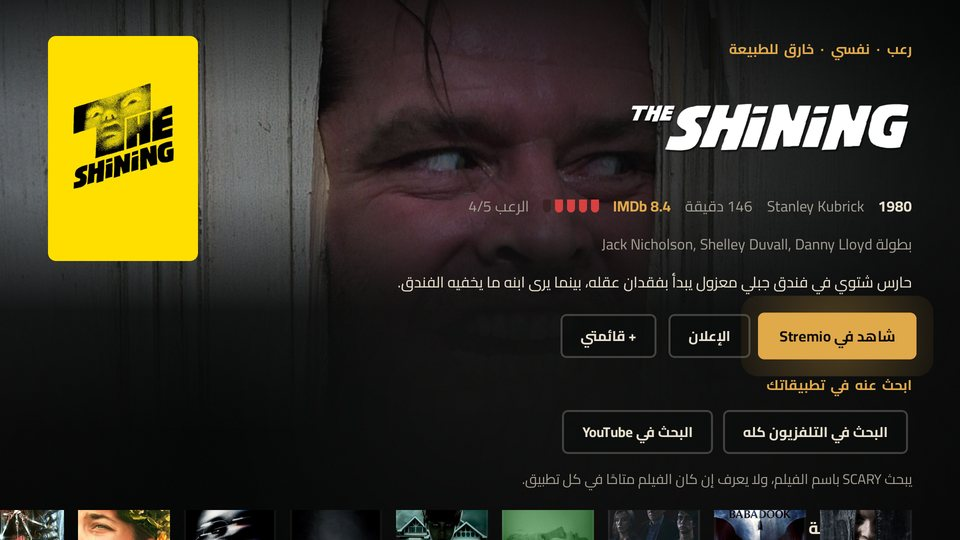</td>
<td width="33%">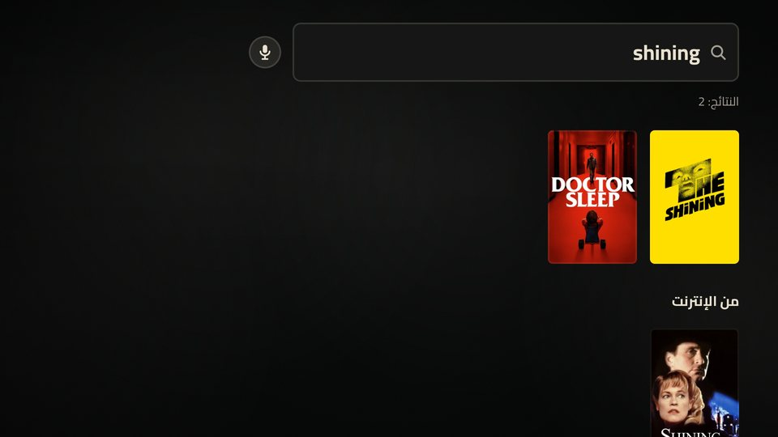</td>
</tr>
</table>

يحوّل SCARY جهاز Android TV إلى صالة سينما للرعب. بدلًا من الشاشة الرئيسية المعتادة تحصل على مكتبة مختارة من أفلام الرعب والإثارة النفسية مع ملصقات وخلفيات حقيقية، و«اختيار الليلة» كل مساء، إلى جانب Stremio وGoogle Play وجميع تطبيقاتك في مكان واحد.

**لماذا SCARY؟**

- 🩸 **170 فيلمًا مختارًا بعناية** مع مقياس للرعب (1–5)، و7 صفوف من الإنترنت (الرائج، جديد هذا العام، الإثارة، الغموض) تواصل التحميل كلما تابعت التمرير: آلاف الأفلام التي تتجدد يوميًا.
- 🌙 **«ماذا تريد أن تشاهد الليلة؟»**: ثمانية أمزجة من ألعاب العقل و«قصير وحاد» إلى «رعب يتصاعد ببطء» و«لا نوم الليلة»، أو اختر عقدًا وحده أو مع مزاج. و«فاجئني» يختار من اختيارك. وصفوف خاصة بالهالوين والجمعة 13.
- 🧟 **صف لكل نوع من الخوف**: لقطات عُثر عليها، رعب فولكلوري، رعب آسيوي، زومبي، مصاصو دماء، رعب الجسد، بيوت مسكونة ومخلوقات، إلى جانب الكلاسيكيات وأفلام القتلة والإثارة النفسية.
- 😱 **قشعريرة**: شعار الفيلم يرتجف ويخفت كمصباح يحتضر، وشاشة مظلمة قبل أن يُفتح الفيلم.
- 📺 **أين تشاهد**: البحث عن الفيلم في التطبيقات المثبتة لديك (Netflix وApple TV وغيرها) وفي بحث Google TV.
- 🛒 **لم تجده؟ استأجره أو اشترِه**: مع مفتاح TMDB، تعرض صفحة الفيلم المتاجر التي تؤجّره أو تبيعه في بلدك، والخدمات التي يشملها اشتراكها. يُؤخذ البلد من إعدادات التلفاز، وليس من موقعك أبدًا. البيانات من JustWatch.
- 👨‍👩‍👧 **سهرة عائلية**: أخف الأفلام فقط في كل مكان، والخروج منها يتطلب رمز PIN.
- 🎲 **«فاجئني»**: فيلم عشوائي ضمن مستوى الرعب الذي تختاره.
- 🎞️ **إعلانات ترويجية تُعرض تلقائيًا**: توقّف عند فيلم فيُعرض إعلانه الترويجي بجانبه بلا صوت (الصوت خيار في الإعدادات). يأتي من YouTube، لذا يسألك SCARY أولًا، ويمكنك إيقافه في أي وقت.
- ⏱️ **"كم لديك من الوقت؟"**: حتى 90 دقيقة، أو أمسية، أو فيلمان متتاليان، أو ماراثون، مع ترقيم الأفلام بترتيب المشاهدة.
- ❤️ **أحببته / ليس لي**: أحببت فيلمًا؟ "لأنك أحببت" يجلب أفلامًا مثله؛ و"ليس لي" يُخرج الفيلم من كل الاقتراحات. **"عامك في الخوف"** يلخّص ما شاهدته.
- 🎟️ **قريبًا في السينما** (مع مفتاح TMDB)، و**امسح للمشاركة**: رمز QR في كل صفحة فيلم يفتح صفحته على IMDb في هاتفك، جاهزة للمشاركة.
- 📡 **مربعات HDMI والبث المباشر** في أجهزة التلفاز ذات المداخل، و**مؤقت نوم** يوقف ما يُعرض مؤقتًا.
- 🔍 **بحث بالكتابة أو بالصوت** في المكتبة وعلى الإنترنت. نتائج الإنترنت أفلام رعب وإثارة وغموض فقط.
- ⭐ **«قائمتي» و«شوهد»**: ضغطة مطوّلة على أي ملصق تحفظه (وضغطة أخرى تزيله)، ويمكنك وضع علامة على ما شاهدته. وعند عودتك من فيلم، يضع SCARY عليه علامة «شوهد» بنفسه.
- 🌫️ **أجواء**: ضباب وحبيبات سينمائية وأصوات خلفية (يمكن إيقافها)، وشاشة توقف بخلفيات من أفلام الرعب.
- 🔒 **قفل أبوي** برمز PIN حسب مستوى الرعب. الفيلم المقفل يظهر بلا ملصق وبلا خلفية.
- 🕯️ **الخصوصية**: بلا حساب وبلا إعلانات وبلا تتبع. كل شيء يُحفظ على التلفاز.
- ♿ **إمكانية الوصول**: تنقّل كامل بجهاز التحكم، ودعم TalkBack، وتباين عالٍ، وبلا وميض.
- 🌍 **الواجهة بالعربية** (من اليمين إلى اليسار) وبالعبرية والإنجليزية والبرتغالية والروسية.

**التثبيت في ثلاث دقائق**

1. اسمح بالتثبيت من مصادر غير معروفة (الإعدادات ← تفضيلات الجهاز ← الأمان والقيود).
2. نزّل وثبّت [`scary.apk`](https://github.com/diamondrubinny/Scary/releases/download/latest-build/scary.apk) (مثلًا عبر تطبيق Send Files to TV).
3. افتح SCARY واختر **اجعل SCARY الشاشة الرئيسية**. إذا لم يعرض التلفاز خيارًا، فعّل **زر الشاشة الرئيسية لـ SCARY** في إعدادات إمكانية الوصول.

> ⚖️ **لا ملفات غير قانونية، ولا فيديو على الإطلاق.** لا يستضيف SCARY ملفات الفيديو ولا يحفظها ولا يبثها ولا يبحث عنها ولا يربط إليها، قانونية كانت أم لا. يعرض معلومات عامة عن الأفلام (الاسم والملصق والتقييم) ويفتح الفيلم في تطبيق مشاهدة مثبّت بالفعل على الجهاز نفسه: التلفاز، أو جهاز لوحي أو هاتف إذا ثبّتّ SCARY عليه (Stremio وNetflix وYouTube وغيرها). تجري المشاهدة بالكامل في ذلك التطبيق ووفق شروطه. لا يثبّت SCARY أي إضافات ولا يوصي بها.

**ادعم SCARY**: المشروع مجاني ومفتوح المصدر. إذا أخافك كما يجب، يمكنك دعمه عبر GitHub Sponsors: ☕ ‎$3 قهوة · 🍿 ‎$5 فشار · 🎟️ ‎$10 تذكرة سينما · 🔪 ‎$25 ليلة رعب. أو [تبرّع عبر PayPal](https://www.paypal.com/donate/?hosted_button_id=U8CEQ95ECPP9J): امسح الرمز بهاتفك (موجود أيضًا في التطبيق، في الإعدادات ← حول التطبيق).

<a href="https://www.paypal.com/donate/?hosted_button_id=U8CEQ95ECPP9J"></a>

</div>

[](https://github.com/sponsors/diamondrubinny) [](https://github.com/sponsors/diamondrubinny) [](https://github.com/sponsors/diamondrubinny) [](https://github.com/sponsors/diamondrubinny)

---

## Português

### A tela inicial que vai fazer você dormir de luz acesa

<table>
<tr>
<td width="33%">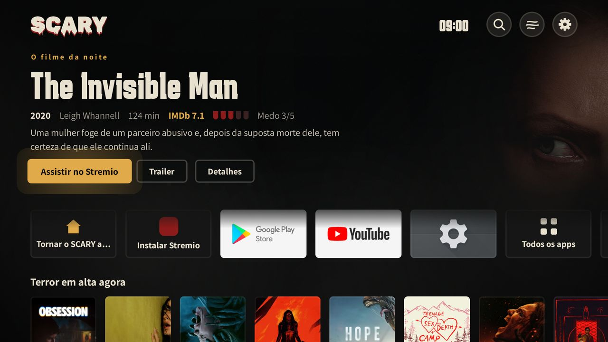</td>
<td width="33%">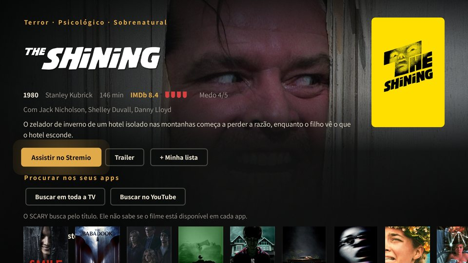</td>
<td width="33%">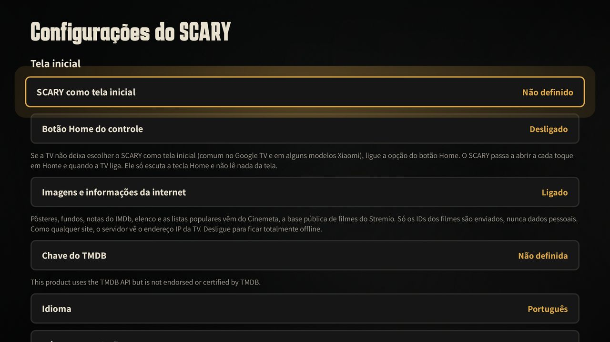</td>
</tr>
</table>

O SCARY transforma sua Android TV em uma sala de cinema de terror. Em vez de uma tela inicial comum, você ganha uma seleção de filmes de terror e suspense psicológico com pôsteres e fundos de verdade, "O filme da noite" todas as noites, e o Stremio, o Google Play e todos os seus apps em um só lugar.

**Por que o SCARY?**

- 🩸 **170 filmes escolhidos a dedo** com medidor de medo (1–5), e mais 7 fileiras da internet (populares, lançamentos do ano, suspense, mistério) que continuam carregando conforme você rola: milhares de filmes, atualizados todos os dias.
- 🌙 **"O que você quer ver hoje à noite?"**: oito climas, de jogos mentais e "curto e afiado" a "terror em fogo lento" e "hoje ninguém dorme", ou escolha uma década, sozinha ou com um clima. O "Surpreenda-me" escolhe dentro da sua escolha. E fileiras especiais para o Halloween e a sexta-feira 13.
- 🧟 **Uma fileira para cada tipo de medo**: found footage, terror folclórico, terror asiático, zumbis, vampiros, horror corporal, casas assombradas e criaturas, ao lado dos clássicos, slashers e thrillers psicológicos.
- 😱 **O arrepio**: o logo do filme treme e pisca como uma lâmpada morrendo, e a tela escurece logo antes de o filme abrir.
- 📺 **Onde assistir**: busque o filme nos apps que você tem (Netflix, Disney+, Prime Video, Apple TV, Max, YouTube, Plex e outros) e na busca do Google TV.
- 🛒 **Não encontrou? Alugue ou compre**: com uma chave do TMDB, a página do filme mostra as lojas que o alugam ou vendem no seu país e os serviços que o incluem na assinatura. O país vem das configurações da TV, nunca da sua localização. Dados da JustWatch.
- 👨‍👩‍👧 **Noite em família**: só os filmes mais leves, em todo lugar, e para sair é preciso o PIN.
- 🎲 **"Surpreenda-me"**: um filme aleatório no nível de medo que você escolher.
- 🎞️ **Trailers que tocam sozinhos**: pare num filme e o trailer dele toca ao lado, sem som (o som é uma opção). Ele vem do YouTube, por isso o SCARY pergunta antes, e dá para desligar quando quiser.
- ⏱️ **"Quanto tempo você tem?"**: até 90 minutos, uma noite, sessão dupla ou maratona, com os filmes numerados na ordem de assistir.
- ❤️ **Amei / Não é pra mim**: ame um filme e "Porque você amou" traz outros parecidos; "não é pra mim" tira o filme de todas as sugestões. **"Seu ano no medo"** resume o que você assistiu.
- 🎟️ **Em breve nos cinemas** (com uma chave TMDB), e **escaneie para compartilhar**: um código QR em cada página de filme abre a página dele no IMDb no celular, pronta para compartilhar.
- 📡 **Blocos de HDMI e TV ao vivo** em TVs com entradas, e um **timer de sono** que pausa o que estiver tocando.
- 🔍 **Busca por texto ou voz**, na coleção e na internet. Da internet vêm só terror, suspense e mistério.
- ⭐ **Minha lista e Visto**: segure OK em qualquer pôster para guardá-lo (segure de novo para tirar) e marque o que você já viu. Ao voltar de um filme, o SCARY o marca como visto sozinho.
- 🌫️ **Atmosfera**: névoa, granulado de cinema e som ambiente (tudo pode ser desligado), e um protetor de tela com fundos de filmes de terror.
- 🔒 **Controle dos pais** com PIN, por nível de medo. Filmes bloqueados aparecem sem pôster e sem fundo.
- 🕯️ **Privacidade**: sem conta, sem anúncios e sem rastreamento. Tudo fica na sua TV.
- ♿ **Acessibilidade**: navegação completa pelo controle remoto, TalkBack, alto contraste e sem piscadas.
- 🌍 **Interface em português**, inglês, hebraico, árabe e russo.

**Instalação em três minutos**

1. Permita a instalação de fontes desconhecidas (Configurações → Preferências do dispositivo → Segurança e restrições).
2. Baixe e instale o [`scary.apk`](https://github.com/diamondrubinny/Scary/releases/download/latest-build/scary.apk) (por exemplo, com o Send Files to TV).
3. Abra o SCARY e escolha **Tornar o SCARY a tela inicial**. Se a TV não oferecer a escolha, ative **SCARY: botão Home** nas configurações de acessibilidade.

> ⚖️ **Nenhum arquivo ilegal, nenhum vídeo.** O SCARY não hospeda, não guarda, não transmite, não procura e não indica arquivos de vídeo, legais ou não. Ele mostra informações públicas sobre filmes (título, pôster, nota) e abre o filme em um app de streaming já instalado no mesmo aparelho: a TV, ou um tablet ou celular se você instalar o SCARY nele (Stremio, Netflix, YouTube e similares). A reprodução acontece inteiramente nesse app, sob os termos dele. O SCARY não instala nem recomenda complementos.

**Apoie o SCARY**: o projeto é gratuito e de código aberto. Se ele te assusta na medida certa, você pode apoiá-lo pelo GitHub Sponsors: ☕ $3 café · 🍿 $5 pipoca · 🎟️ $10 ingresso de cinema · 🔪 $25 noite de terror. Ou [doe pelo PayPal](https://www.paypal.com/donate/?hosted_button_id=U8CEQ95ECPP9J): aponte a câmera do celular para o código (ele também está no app, em Configurações → Sobre).

<a href="https://www.paypal.com/donate/?hosted_button_id=U8CEQ95ECPP9J"></a>

[](https://github.com/sponsors/diamondrubinny) [](https://github.com/sponsors/diamondrubinny) [](https://github.com/sponsors/diamondrubinny) [](https://github.com/sponsors/diamondrubinny)

---

## Русский

### Главный экран, после которого не захочется выключать свет

<table>
<tr>
<td width="33%">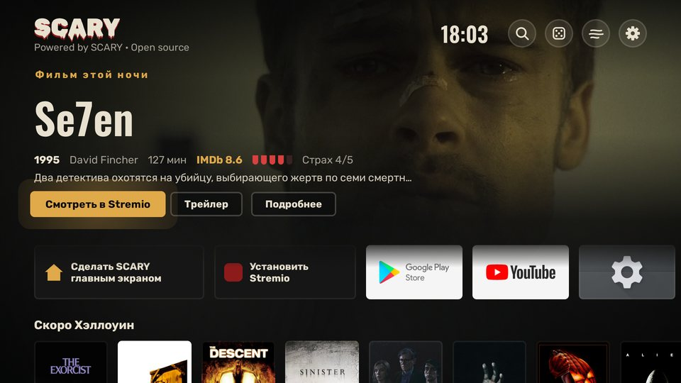</td>
<td width="33%">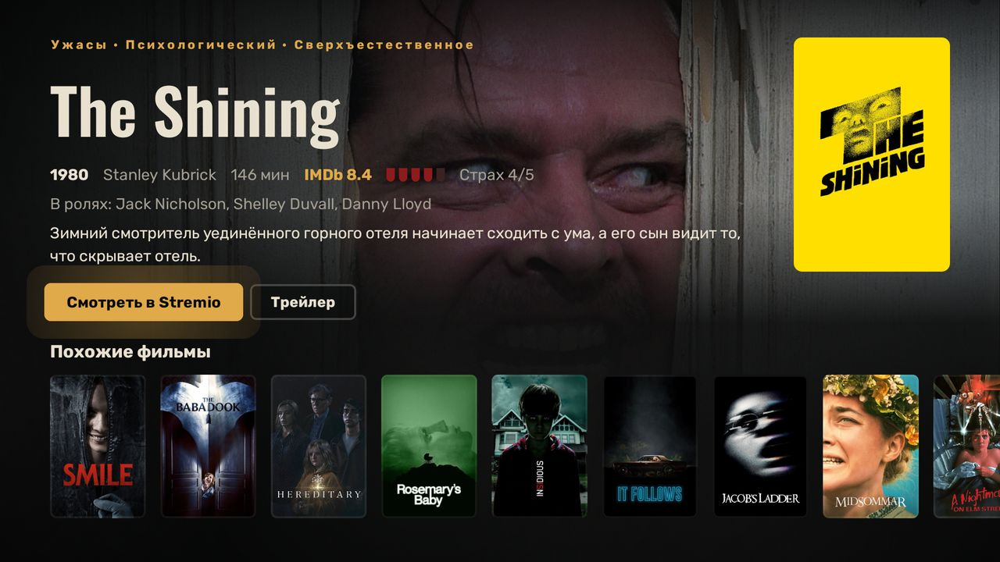</td>
<td width="33%">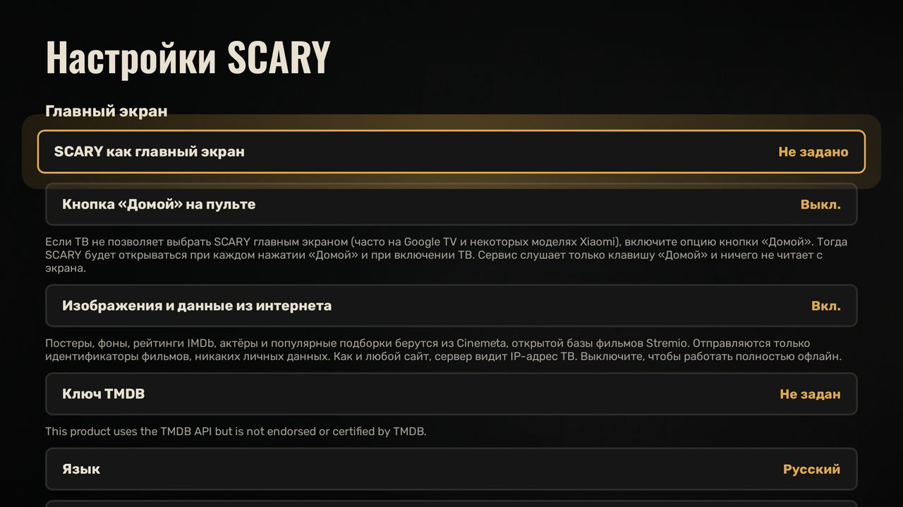</td>
</tr>
</table>

SCARY превращает ваш Android TV в кинозал ужасов. Вместо обычного главного экрана — отобранная коллекция фильмов ужасов и психологических триллеров с настоящими постерами и фонами, «Фильм этой ночи» каждый вечер, а также Stremio, Google Play и все ваши приложения в одном месте.

**Почему SCARY?**

- 🩸 **170 отобранных вручную фильмов** со шкалой страха (1–5) и 7 рядов из интернета (популярное, новинки года, триллеры, загадки), которые подгружаются по мере прокрутки: тысячи фильмов, обновляемых каждый день.
- 🌙 **«Что посмотреть сегодня ночью?»**: восемь настроений, от «Игр разума» и «Коротко и остро» до «Медленно нарастающего ужаса» и «Сегодня не уснуть», или выберите десятилетие, отдельно или вместе с настроением. «Удиви меня» выбирает из вашего выбора. И особые ряды к Хэллоуину и пятнице 13-го.
- 🧟 **Ряд для каждого вида страха**: найденная плёнка, фолк-хоррор, азиатские ужасы, зомби, вампиры, боди-хоррор, дома с привидениями и чудовища, рядом с классикой, слэшерами и психологическими триллерами.
- 😱 **Дрожь**: логотип фильма дрожит и мерцает, как умирающая лампа, а перед запуском фильма экран темнеет.
- 📺 **Где смотреть**: поиск фильма в установленных приложениях (Netflix, Apple TV и другие) и в поиске Google TV.
- 🛒 **Не нашли? Арендуйте или купите**: с ключом TMDB страница фильма показывает магазины, которые сдают его в аренду или продают в вашей стране, и сервисы, где он входит в подписку. Страна берётся из настроек телевизора, никогда не из местоположения. Данные JustWatch.
- 👨‍👩‍👧 **Семейный вечер**: везде только самые мягкие фильмы, выход — по PIN-коду.
- 🎲 **«Удиви меня»**: случайный фильм в пределах выбранного уровня страха.
- 🎞️ **Трейлеры запускаются сами**: задержитесь на фильме, и рядом без звука пойдёт его трейлер (звук включается в настройках). Он берётся с YouTube, поэтому SCARY сначала спрашивает, и это можно выключить в любой момент.
- ⏱️ **«Сколько у вас времени?»**: до 90 минут, вечер, двойной сеанс или марафон, с фильмами, пронумерованными в порядке просмотра.
- ❤️ **Понравилось / Не моё**: отметьте фильм, и «Потому что вам понравился» подберёт похожие; «не моё» убирает фильм из всех подсказок. **«Ваш год страха»** подводит итоги просмотренного.
- 🎟️ **Скоро в кино** (с ключом TMDB) и **сканируйте, чтобы поделиться**: QR-код на странице каждого фильма открывает его страницу IMDb на телефоне, готовую, чтобы поделиться.
- 📡 **Плитки HDMI и эфирного ТВ** на телевизорах со входами и **таймер сна**, который ставит воспроизведение на паузу.
- 🔍 **Поиск текстом или голосом** — в коллекции и в интернете. Из интернета приходят только ужасы, триллеры и детективы.
- ⭐ **«Мой список» и «Просмотрено»**: удерживайте OK на постере, чтобы сохранить фильм (ещё раз — чтобы убрать), и отмечайте просмотренное. Когда вы возвращаетесь после фильма, SCARY сам отмечает его просмотренным.
- 🌫️ **Атмосфера**: туман, киноплёночное зерно и фоновые звуки (можно отключить), а также заставка с кадрами из фильмов ужасов.
- 🔒 **Родительский замок** с PIN-кодом по уровню страха. Заблокированные фильмы показываются без постера и фона.
- 🕯️ **Приватность**: без аккаунта, без рекламы и без слежки. Всё хранится на телевизоре.
- ♿ **Доступность**: полное управление с пульта, TalkBack, высокая контрастность, без мигания.
- 🌍 **Интерфейс** на русском, английском, португальском, иврите и арабском.

**Установка за три минуты**

1. Разрешите установку из неизвестных источников (Настройки → Настройки устройства → Безопасность и ограничения).
2. Скачайте и установите [`scary.apk`](https://github.com/diamondrubinny/Scary/releases/download/latest-build/scary.apk) (например, через Send Files to TV).
3. Откройте SCARY и выберите **Сделать SCARY главным экраном**. Если ТВ не предлагает выбор, включите **SCARY: кнопка «Домой»** в разделе специальных возможностей.

> ⚖️ **Никаких нелегальных файлов и никакого видео.** SCARY не размещает, не хранит, не транслирует, не ищет видеофайлы и не даёт на них ссылок — ни легальные, ни любые другие. Он показывает общедоступную информацию о фильмах (название, постер, рейтинг) и открывает фильм в приложении для просмотра, уже установленном на том же устройстве: на телевизоре, а также на планшете или телефоне, если вы установили SCARY туда (Stremio, Netflix, YouTube и подобные). Просмотр полностью происходит в этом приложении и по его правилам. SCARY не устанавливает и не рекомендует дополнения.

**Поддержите SCARY**: проект бесплатный и с открытым кодом. Если он пугает вас как надо, поддержите его через GitHub Sponsors: ☕ $3 кофе · 🍿 $5 попкорн · 🎟️ $10 билет в кино · 🔪 $25 вечер ужасов. Или [пожертвуйте через PayPal](https://www.paypal.com/donate/?hosted_button_id=U8CEQ95ECPP9J): наведите камеру телефона на код (он есть и в приложении: Настройки → О приложении).

<a href="https://www.paypal.com/donate/?hosted_button_id=U8CEQ95ECPP9J"></a>

[](https://github.com/sponsors/diamondrubinny) [](https://github.com/sponsors/diamondrubinny) [](https://github.com/sponsors/diamondrubinny) [](https://github.com/sponsors/diamondrubinny)

---

## For developers

| Module | What it is |
|--------|-----------|
| `core/` | Pure Kotlin/JVM: catalog model and validation, search, tonight's pick, Cinemeta and TMDB parsing, PIN hashing, deep links. Unit tested. |
| `app/` | Android app: Jetpack Compose UI, HOME intent filter, Home-button accessibility service, installed apps, launching. |
| `app/src/main/assets/catalog.json` | The curated library: synopses in Hebrew, English, Portuguese, Russian and Arabic, collection titles in all five. Validated by the `core` tests on every build. |

```bash
./gradlew :core:test          # unit tests
./gradlew :app:assembleDebug  # app/build/outputs/apk/debug/app-debug.apk
./gradlew :app:lintDebug
./gradlew -Pscary.coreOnly :core:test   # without the Android SDK
```

CI (GitHub Actions) runs the tests, builds and lints the APK, builds the optimized release APK (R8), smoke-tests it on an Android TV emulator, captures these screenshots there, and only then publishes it to the `latest-build` pre-release.

Plan and spec (Hebrew): [docs/PLAN.md](docs/PLAN.md).
Video ad: `python3 tools/promo/make_ad.py --lang en|he --out scary-ad.mp4` renders it from the CI screenshots, with a synthesized soundtrack (needs Pillow with libraqm, numpy and ffmpeg). Storyboard: [docs/promo/STORYBOARD.md](docs/promo/STORYBOARD.md).
Privacy data map and draft policy: [docs/PRIVACY.md](docs/PRIVACY.md). Accessibility review and draft statement: [docs/ACCESSIBILITY.md](docs/ACCESSIBILITY.md). Draft terms of use: [docs/TERMS.md](docs/TERMS.md). Release checklist: [docs/RELEASE_CHECKLIST.md](docs/RELEASE_CHECKLIST.md). Quality report (tests, lint, security review, visual check): [docs/QA_REPORT.md](docs/QA_REPORT.md). The privacy notice and accessibility statement are also in the app, under Settings → About.

## Privacy and credits

 **Movie information and images: [TMDB](https://www.themoviedb.org) and Cinemeta (Stremio).** This product uses the TMDB API but is not endorsed or certified by TMDB.

No accounts, no analytics. Online artwork can be switched off in settings; only movie IDs (and your search text when you search) are sent to Cinemeta and, with your own key, TMDB. Movie metadata and images belong to their owners. Fonts: Karantina, Assistant, Oswald, Rubik, Rubik Wet Paint, Rakkas and Cairo, under the SIL Open Font License 1.1.

## License and credit

**Powered by SCARY · Open source · [github.com/diamondrubinny/Scary](https://github.com/diamondrubinny/Scary)**

SCARY is licensed under the [Apache License 2.0](LICENSE). If you share a copy or build your own version, keep the [NOTICE](NOTICE) file and the "Powered by SCARY · Open source" credit in the app (Apache-2.0, section 4(d)). Every source file carries the credit, and CI fails without it.


---

## 💼 Commercial license & rights acquisition

SCARY is free and open source under the Apache-2.0. If you are interested in a **commercial agreement** or custom licensing terms, **white-label / exclusive rights**, or **acquiring full rights to the code**, send your proposal to **[d@rubinny.net](mailto:d@rubinny.net)**.

Please include: who you are (company / contact), how you intend to use the code, and your offer.

> 🇮🇱 מעוניינים ברישיון מסחרי, בזכויות בלעדיות או ברכישת הזכויות בקוד? שלחו הצעה ל-**[d@rubinny.net](mailto:d@rubinny.net)** — כולל פרטי קשר, אופן השימוש המתוכנן וההצעה שלכם.
