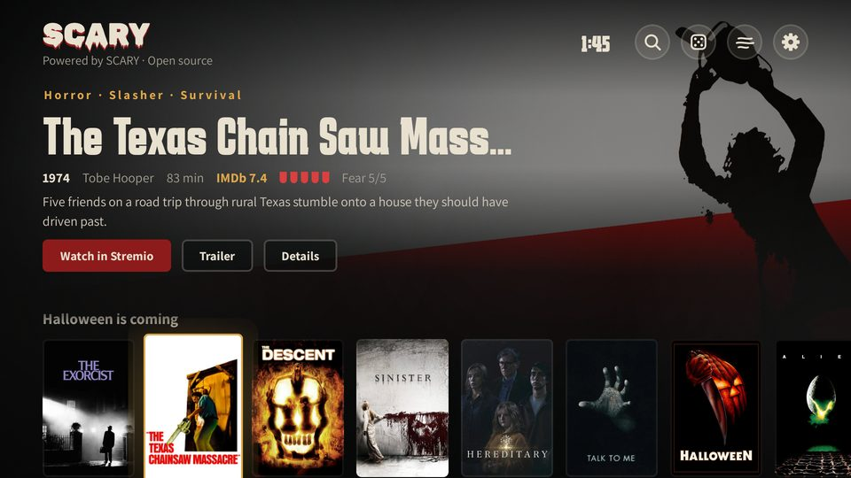

<p align="center"></p>

<h1 align="center">SCARY</h1>

<p align="center">
<b>The horror home screen for Android TV.</b><br>
<a href="#עברית">עברית</a> · <a href="#العربية">العربية</a> · <a href="#русский">Русский</a> · <a href="#for-developers">Developers</a>
</p>

<p align="center">
<a href="https://github.com/diamondrubinny/Scary/releases/download/latest-build/scary.apk"></a>
<a href="https://github.com/sponsors/diamondrubinny"></a>
</p>

<table>
<tr>
<td width="33%"><br><b>Tonight's pick</b> · a new horror film every night, full-screen artwork</td>
<td width="33%"><br><b>Movie pages</b> · logo art, fear meter, and a search in every app you have</td>
<td width="33%"><br><b>The shiver</b> · the title trembles in the dark before the movie opens</td>
</tr>
<tr>
<td><br><b>What do you feel like tonight?</b> · six moods, from mind games to no sleep</td>
<td><br><b>Family night</b> · only the gentlest films, PIN to leave</td>
<td><br><b>Search</b> · by text or voice, in the library and across the web</td>
</tr>
<tr>
<td><br><b>My list</b> · hold OK on any poster to keep it</td>
<td><br><b>Horror screensaver</b> · backdrops that fade in the dark</td>
<td><br><b>Five languages</b> · Hebrew and Arabic right to left, English, Portuguese, Russian</td>
</tr>
<tr>
<td><br><b>Your apps</b> · Stremio, Google Play and every TV app, pinned your way</td>
<td><br><b>Settings</b> · parental PIN, family night, seasonal rows, effects</td>
<td><br><b>Private by design</b> · no account, no ads, no tracking</td>
</tr>
</table>

<p align="center"><sub>Real screenshots: every build is installed on an Android TV emulator (1080p) and captured automatically.</sub></p>

---

<div dir="rtl">

## עברית

### מסך הבית שישאיר לכם את האור דולק

SCARY הופך את ה־Android TV שלכם לאולם קולנוע של אימה. במקום מסך בית רגיל מקבלים מאגר מאוצר של סרטי אימה ומתח פסיכולוגי עם פוסטרים ורקעים אמיתיים, "הסרט של הלילה" בכל ערב, ואת Stremio, Google Play וכל האפליקציות שלכם במקום אחד.

**למה SCARY?**

- 🩸 **52 סרטים שנבחרו ביד** עם מד פחד (1–5), ועוד 7 שורות מהרשת (פופולרי, חדש השנה, מותחנים, תעלומות) עם מאות סרטים שמתעדכנים כל יום.
- 🌙 **"מה בא לך הלילה?"**: שישה מצבי רוח, משחקי מוח ועד "לא לישון הלילה", ושורות מיוחדות להלואין ולשישי ה־13.
- 😱 **צמרמורת**: הלוגו של הסרט רועד ומהבהב כמו נורה גוססת, ומסך חשוך רגע לפני שהסרט נפתח.
- 📺 **איפה לצפות**: חיפוש הסרט באפליקציות שמותקנות אצלכם (Netflix, ‏Apple TV, ‏yes, ‏HOT, סלקום TV ועוד) ובחיפוש של Google TV.
- 👨‍👩‍👧 **ערב משפחתי**: רק הסרטים העדינים ביותר, בכל מקום, והיציאה דורשת PIN.
- 🎲 **"הפתע אותי"**: סרט אקראי ברמת הפחד שבחרתם.
- 🔍 **חיפוש בהקלדה או בקול**, במאגר וגם ברשת.
- ⭐ **"הרשימה שלי"**: לחיצה ארוכה על פוסטר שומרת אותו.
- 🌫️ **אווירה**: ערפל, גרעיניות קולנועית וצלילי רקע (אפשר לכבות), ושומר מסך עם רקעים מסרטי אימה.
- 🔒 **נעילת הורים** בקוד PIN, לפי רמת הפחד.
- 🕯️ **פרטיות**: בלי חשבון, בלי פרסומות ובלי מעקב. הכל נשמר בטלוויזיה.
- ♿ **נגישות**: ניווט מלא בשלט, TalkBack, ניגודיות גבוהה וללא הבהובים.
- 🌍 **ממשק בעברית ובערבית** (מימין לשמאל), באנגלית, בפורטוגזית וברוסית.

**התקנה בשלוש דקות**

1. אפשרו התקנה ממקורות לא ידועים (הגדרות ← העדפות מכשיר ← אבטחה והגבלות).
2. הורידו והתקינו את [`scary.apk`](https://github.com/diamondrubinny/Scary/releases/download/latest-build/scary.apk) (למשל עם Send Files to TV).
3. פתחו את SCARY ובחרו **הגדרת SCARY כמסך הבית**. אם הטלוויזיה לא מציעה בחירה, הפעילו את **SCARY: כפתור הבית** בהגדרות הנגישות. מדריך מלא ל־Xiaomi: [docs/XIAOMI_SETUP.md](docs/XIAOMI_SETUP.md).

SCARY לא מזרים ולא מארח סרטים: בחירת סרט פותחת אותו ב־Stremio.

**תמיכה ב־SCARY**: הפרויקט חינמי ובקוד פתוח. אם הוא מפחיד אתכם כמו שצריך, אפשר לתמוך דרך GitHub Sponsors: ☕ ‎$3 קפה · 🍿 ‎$5 פופקורן · 🎟️ ‎$10 כרטיס לקולנוע · 🔪 ‎$25 ערב אימה.

</div>

[](https://github.com/sponsors/diamondrubinny) [](https://github.com/sponsors/diamondrubinny) [](https://github.com/sponsors/diamondrubinny) [](https://github.com/sponsors/diamondrubinny)

---

<div dir="rtl">

## العربية

### شاشة رئيسية ستجعلك تترك الضوء مضاءً

يحوّل SCARY جهاز Android TV إلى صالة سينما للرعب. بدلًا من الشاشة الرئيسية المعتادة تحصل على مكتبة مختارة من أفلام الرعب والإثارة النفسية مع ملصقات وخلفيات حقيقية، و«فيلم الليلة» كل مساء، إلى جانب Stremio وGoogle Play وجميع تطبيقاتك في مكان واحد.

**لماذا SCARY؟**

- 🩸 **52 فيلمًا مختارًا بعناية** مع مقياس للرعب (1–5)، و7 صفوف من الإنترنت (الرائج، جديد هذا العام، الإثارة، الغموض) بمئات الأفلام التي تتجدد يوميًا.
- 🌙 **«ماذا تريد أن تشاهد الليلة؟»**: ستة أمزجة من ألعاب العقل إلى «لا نوم الليلة»، وصفوف خاصة بالهالوين والجمعة 13.
- 😱 **قشعريرة**: شعار الفيلم يرتجف ويخفت كمصباح يحتضر، وشاشة مظلمة قبل أن يُفتح الفيلم.
- 📺 **أين تشاهد**: البحث عن الفيلم في التطبيقات المثبتة لديك (Netflix وApple TV وغيرها) وفي بحث Google TV.
- 👨‍👩‍👧 **سهرة عائلية**: أخف الأفلام فقط في كل مكان، والخروج منها يتطلب رمز PIN.
- 🎲 **«فاجئني»**: فيلم عشوائي ضمن مستوى الرعب الذي تختاره.
- 🔍 **بحث بالكتابة أو بالصوت** في المكتبة وعلى الإنترنت.
- ⭐ **«قائمتي»**: ضغطة مطوّلة على أي ملصق تحفظه.
- 🌫️ **أجواء**: ضباب وحبيبات سينمائية وأصوات خلفية (يمكن إيقافها)، وشاشة توقف بخلفيات من أفلام الرعب.
- 🔒 **قفل أبوي** برمز PIN حسب مستوى الرعب.
- 🕯️ **الخصوصية**: بلا حساب وبلا إعلانات وبلا تتبع. كل شيء يُحفظ على التلفاز.
- ♿ **إمكانية الوصول**: تنقّل كامل بجهاز التحكم، ودعم TalkBack، وتباين عالٍ، وبلا وميض.
- 🌍 **الواجهة بالعربية** (من اليمين إلى اليسار) وبالعبرية والإنجليزية والبرتغالية والروسية.

**التثبيت في ثلاث دقائق**

1. اسمح بالتثبيت من مصادر غير معروفة (الإعدادات ← تفضيلات الجهاز ← الأمان والقيود).
2. نزّل وثبّت [`scary.apk`](https://github.com/diamondrubinny/Scary/releases/download/latest-build/scary.apk) (مثلًا عبر تطبيق Send Files to TV).
3. افتح SCARY واختر **اجعل SCARY الشاشة الرئيسية**. إذا لم يعرض التلفاز خيارًا، فعّل **زر الشاشة الرئيسية لـ SCARY** في إعدادات إمكانية الوصول.

لا يبث SCARY الأفلام ولا يستضيفها: اختيار فيلم يفتحه في Stremio.

**ادعم SCARY**: المشروع مجاني ومفتوح المصدر. إذا أخافك كما يجب، يمكنك دعمه عبر GitHub Sponsors: ☕ ‎$3 قهوة · 🍿 ‎$5 فشار · 🎟️ ‎$10 تذكرة سينما · 🔪 ‎$25 ليلة رعب.

</div>

[](https://github.com/sponsors/diamondrubinny) [](https://github.com/sponsors/diamondrubinny) [](https://github.com/sponsors/diamondrubinny) [](https://github.com/sponsors/diamondrubinny)

---

## Русский

### Главный экран, после которого не захочется выключать свет

SCARY превращает ваш Android TV в кинозал ужасов. Вместо обычного главного экрана — отобранная коллекция фильмов ужасов и психологических триллеров с настоящими постерами и фонами, «Фильм на ночь» каждый вечер, а также Stremio, Google Play и все ваши приложения в одном месте.

**Почему SCARY?**

- 🩸 **52 отобранных вручную фильма** со шкалой страха (1–5) и 7 рядов из интернета (популярное, новинки года, триллеры, загадки) — сотни фильмов, которые обновляются каждый день.
- 🌙 **«Что посмотреть сегодня ночью?»**: шесть настроений, от «Игр разума» до «Сегодня не уснуть», и особые ряды к Хэллоуину и пятнице 13-го.
- 😱 **Дрожь**: логотип фильма дрожит и мерцает, как умирающая лампа, а перед запуском фильма экран темнеет.
- 📺 **Где смотреть**: поиск фильма в установленных приложениях (Netflix, Apple TV и другие) и в поиске Google TV.
- 👨‍👩‍👧 **Семейный вечер**: везде только самые мягкие фильмы, выход — по PIN-коду.
- 🎲 **«Удиви меня»**: случайный фильм в пределах выбранного уровня страха.
- 🔍 **Поиск текстом или голосом** — в коллекции и в интернете.
- ⭐ **«Мой список»**: удерживайте OK на постере, чтобы сохранить фильм.
- 🌫️ **Атмосфера**: туман, киноплёночное зерно и фоновые звуки (можно отключить), а также заставка с кадрами из фильмов ужасов.
- 🔒 **Родительский замок** с PIN-кодом по уровню страха.
- 🕯️ **Приватность**: без аккаунта, без рекламы и без слежки. Всё хранится на телевизоре.
- ♿ **Доступность**: полное управление с пульта, TalkBack, высокая контрастность, без мигания.
- 🌍 **Интерфейс** на русском, английском, португальском, иврите и арабском.

**Установка за три минуты**

1. Разрешите установку из неизвестных источников (Настройки → Настройки устройства → Безопасность и ограничения).
2. Скачайте и установите [`scary.apk`](https://github.com/diamondrubinny/Scary/releases/download/latest-build/scary.apk) (например, через Send Files to TV).
3. Откройте SCARY и выберите **Сделать SCARY главным экраном**. Если ТВ не предлагает выбор, включите **SCARY: кнопка «Домой»** в разделе специальных возможностей.

SCARY не транслирует и не хранит фильмы: выбранный фильм открывается в Stremio.

**Поддержите SCARY**: проект бесплатный и с открытым кодом. Если он пугает вас как надо, поддержите его через GitHub Sponsors: ☕ $3 кофе · 🍿 $5 попкорн · 🎟️ $10 билет в кино · 🔪 $25 вечер ужасов.

[](https://github.com/sponsors/diamondrubinny) [](https://github.com/sponsors/diamondrubinny) [](https://github.com/sponsors/diamondrubinny) [](https://github.com/sponsors/diamondrubinny)

---

## For developers

| Module | What it is |
|--------|-----------|
| `core/` | Pure Kotlin/JVM: catalog model and validation, search, tonight's pick, Cinemeta and TMDB parsing, PIN hashing, deep links. Unit tested. |
| `app/` | Android app: Jetpack Compose UI, HOME intent filter, Home-button accessibility service, installed apps, launching. |
| `app/src/main/assets/catalog.json` | The curated library: synopses in Hebrew, English, Portuguese, Russian and Arabic, collection titles in all five. Validated by the `core` tests on every build. |

```bash
./gradlew :core:test          # unit tests
./gradlew :app:assembleDebug  # app/build/outputs/apk/debug/app-debug.apk
./gradlew :app:lintDebug
./gradlew -Pscary.coreOnly :core:test   # without the Android SDK
```

CI (GitHub Actions) runs the tests, builds and lints the APK, builds the optimized release APK (R8), smoke-tests it on an Android TV emulator, captures these screenshots there, and only then publishes it to the `latest-build` pre-release.

Plan and spec (Hebrew): [docs/PLAN.md](docs/PLAN.md).
Privacy data map and draft policy: [docs/PRIVACY.md](docs/PRIVACY.md). Accessibility review and draft statement: [docs/ACCESSIBILITY.md](docs/ACCESSIBILITY.md). Draft terms of use: [docs/TERMS.md](docs/TERMS.md). Release checklist: [docs/RELEASE_CHECKLIST.md](docs/RELEASE_CHECKLIST.md). The privacy notice and accessibility statement are also in the app, under Settings → About.

## Privacy and credits

No accounts, no analytics. Online artwork can be switched off in settings; only movie IDs (and your search text when you search) are sent to Cinemeta and, with your own key, TMDB. This product uses the TMDB API but is not endorsed or certified by TMDB. Movie metadata and images belong to their owners. Fonts: Karantina, Assistant, Oswald, Rubik, Rubik Wet Paint, Rakkas and Cairo, under the SIL Open Font License 1.1.

## License and credit

**Powered by SCARY · Open source · [github.com/diamondrubinny/Scary](https://github.com/diamondrubinny/Scary)**

SCARY is licensed under the [Apache License 2.0](LICENSE). If you share a copy or build your own version, keep the [NOTICE](NOTICE) file and the "Powered by SCARY · Open source" credit in the app (Apache-2.0, section 4(d)). Every source file carries the credit, and CI fails without it.
